

# ifthenpay | Pay Button

Take ifthenpay payments anywhere: pay buttons for any page, shareable pay links, and a link builder for plugins ifthenpay has no integration with.

---

## Table of Contents

- [Description](#description)
- [Key Features](#key-features)
- [Requirements](#requirements)
- [Installation](#installation)
- [Frequently Asked Questions](#frequently-asked-questions)
- [External Services](#external-services)
- [Screenshots](#screenshots)
- [Support](#support)
- [Security](#security)
- [Changelog](#changelog)

### Description

ifthenpay | Pay Button lets you take ifthenpay payments on any WordPress site, with no shop, form or booking plugin needed. You create a pay button, set its amount and the details you need, and place it on any page with a shortcode or a block. Every button also has its own pay page, so you can share it as a link.

The payer fills in a short checkout, then pays on ifthenpay's secure hosted payment page with any method enabled on your account. ifthenpay confirms the payment to your site with a server-side callback, and the payer comes back to a "Paid" message, a page or a URL of your choice. No card or bank details ever touch your site.

Already using a form or booking plugin ifthenpay has no integration with? Point its "redirect after submit" at a button's pay link and fill in the amount, name and email with that plugin's own merge tags. A signed webhook tells the other plugin (or Zapier, Make or n8n) when the payment is paid.

**In plain terms you get:**

- Pay buttons for any page or post, as a shortcode or a block, plus a pay page per button to share as a link
- Fixed amounts, amounts the payer chooses (donations, tips) or amounts sent by another plugin
- Your own checkout questions, multi-step checkouts, and limited spots per button or per option (dates, sessions, sizes)
- A Payments screen with totals, filters and CSV export, receipts by email, and secure automatic payment confirmations (no card numbers stored)

All settings are made in **Pay Button** in your WordPress admin and in your ifthenpay Backoffice. The plugin is built so site owners can take payments without needing deep technical knowledge.

### Key Features

1. Pay buttons that work on any page: shortcode `[ifthenpay_button id="…"]`, an **ifthenpay Pay Button** block, and a pay page per button (`/pay/{button}/`)
2. Three amount modes: **Fixed**, **Payer chooses** (with suggested amounts and a minimum and maximum) and **From the link**
3. A checkout form builder: name, email, phone, tax number (NIF) and note, plus your own questions (text, number, date, dropdown, single or multiple choice, agreement, text blocks) and page breaks for multi-step checkouts; any question or text block can show only for some answers (e.g. a dietary question just for the in-person day)
4. **Spots**: limit how many people can pay, in total or per option, each option with its own price; the payer can pick a quantity, and sold-out options are greyed out
5. Full design control: match your theme's buttons or design your own (filled, outline, soft, gradient or glass, with lift, shine or pulse effects), plus a site-wide (or per-button) look for the checkout, the pay page and the popups, with a live preview: a glow, gradient, image or looping video background with Crystals, Waves, Bokeh or Grain, a see-through frosted-glass card, and a dark mode that follows the payer's device; the checkout can open over the pay page's background instead of a dimmed page
6. Every payer-facing word can be rewritten in the **Texts** tab, in any language
7. After payment: a popup message, a WordPress page or a custom URL, with merge tags such as `{name}`, `{amount}` and `{payment_id}`
8. A bridge for any other plugin: a redirect link builder, signed links for developers, and a signed outgoing webhook (Zapier, Make, n8n); plus a direct request to your invoicing app (InvoiceXpress, Moloni, Vendus, TOConline…) the moment a payment is paid, written in that app's own format with merge tags
9. Support for multiple payment methods (Multibanco, MB WAY, Payshop, Credit Card, Google Pay, Apple Pay, Pix and more — whatever is enabled on your Gateway Key), synced live from your ifthenpay account, with in-admin **Request Activation** for methods not yet enabled
10. Secure redirect to ifthenpay's hosted payment page, in Portuguese, English, Spanish or French to match your site's language
11. Revenue, the share of payers who opened the checkout but didn't pay, and how full the spots are, right on the Buttons screen; a Payments screen with charts, totals by status, search, filters, columns, CSV export, manual status changes and payment emails, plus a Dashboard widget and an optional weekly summary email
12. Receipts for the payer and a notice for you, sent once ifthenpay confirms a payment
13. Security first: no card data stored, anti-phishing key on every callback, signed return and result links

### Requirements

- An active ifthenpay merchant account — [subscribe here](https://ifthenpay.com/aderir/) to obtain your credentials.
- Your ifthenpay **Backoffice Key**, and a **Gateway Key** for ifthenpay Pay Button (request it from ifthenpay support/helpdesk).
- The payment methods you want enabled on that Gateway Key (our helpdesk team will guide you).
- WordPress 6.4+ and PHP 7.4+.
- HTTPS (SSL) enabled on your site.

No other plugin is needed.

### Installation

1. **Install:** Upload the plugin zip via `Plugins → Add New → Upload`, or install from WordPress.org and Activate.
2. **Credentials:** Ensure your ifthenpay account has an active Pay Button Gateway Key with the desired payment methods enabled.

#### Step 1 — Connect your ifthenpay account

1. Open **Pay Button › Gateway Configuration** and click **Connect** under **ifthenpay account**.
2. Paste your **Backoffice Key**.
3. Click **Connect**.

(screenshot 1)

#### Step 2 — Choose the Gateway Key and the payment methods

1. Choose your **Gateway Key** (only needed if you have more than one).
2. Switch on the **payment methods** to offer and star the **default** one the ifthenpay page opens on.
3. For a method that isn't active on your contract yet, click **Request Activation**.
4. Click **Save Settings**.

(screenshot 2)

#### Step 3 — Set the ifthenpay page description, link expiry and weekly summary

1. **Description**: what the payer reads on the ifthenpay page. Click a **tag** to fill in each payment's details, e.g. `{button}`.
2. **Expiry days**: how long an unpaid payment link stays open before it's marked Expired.
3. Optional: a **weekly summary** email every Monday.
4. Click **Save Settings**.

(screenshot 3)

These settings apply to every button. Further down, **Display** sets how the plugin's admin screens and Dashboard widget look.

#### Step 4 — Create a pay button

1. Open **Pay Button › Buttons**.
2. Click **New button**.
3. Each card shows the button, what it collected, and its spots. The switch turns a button **on or off**.
4. **Edit**, copy the **shortcode**, copy the **pay link**, open the **pay page**, **duplicate** or **delete**.

(screenshot 4)

#### Step 5 — Set the button's checkout: title, pay link and amount

1. **Title** and **Description**: what the payer sees at the top of the checkout.
2. **Hosted payment page description** (optional): overrides the one in Gateway Configuration for this button.
3. **Pay link**: the address of the button's own pay page.
4. Switch on **Take payments**.
5. **Amount**: **Fixed**, **Payer chooses** (donations, tips, with suggested amounts) or **From the link** (another plugin sends the total).

(screenshot 5)

#### Step 6 — Ask for the payer's details and build the checkout form

1. **Payer details**: set **Name**, **Email**, **Phone**, **Tax number (NIF)** and a **Note** to Off, Optional or Required. With an email, the payer gets a receipt.
2. **Checkout form**: move items up or down, open one to edit it, or delete it.
3. **Add** your own questions: text, number, date, dropdown, single or multiple choice, agreement, text blocks, and **page breaks** to split it into steps.

(screenshot 6)

#### Step 7 — Optional: limit the spots, in total or per option

1. **Spots**: **No limit**, **Limited spots**, or **Spots per option** (each option of one choice field gets its own spots and price).
2. **Split by**: the Dropdown, Single choice or Multiple choice field whose options have spots.
3. **Total spots** (optional): a cap across every option.

(screenshot 7)

Below these, **Payer picks how many** lets the payer choose a quantity (capped by **Most in one payment**), and **Say when few are left** shows "Only X left" in the checkout. An unpaid payment keeps its spot until its ifthenpay link expires.

At the bottom of the Checkout tab, **Payment methods** lets a button offer only some of your methods. Leave them all unticked to offer every method switched on in Gateway Configuration.

#### Step 8 — Design the button and save it

1. Open the **Button design** tab.
2. **Button text**, then **Match my theme** or a **Custom** colour, shape, size and icon.
3. Click **Save button**.

(screenshot 8)

The **Checkout design** tab can give this button its own checkout, pay page and popup look instead of the site's. **After payment** chooses what happens when it's paid and how long its payment link stays open.

#### Step 9 — Place the button on a page, or share its pay link

1. Copy the **shortcode** and paste it on any page or post.
2. Or share the **pay link**: the button's own pay page, for emails, social posts or a QR code.
3. In the block editor, add the **ifthenpay Pay Button** block and pick this button.

(screenshot 9)

The shortcode also takes `label` (the button text) and `align` (`left`, `center` or `right`), e.g. `[ifthenpay_button id="123" label="Donate" align="center"]`.

#### Optional — Connect a form or booking plugin ifthenpay has no integration with

1. Open the **Connect** tab.
2. Tick the values the other plugin sends and swap each `{tag}` for that plugin's own merge tag. Copy the **Redirect link** into its "redirect after submit" setting.
3. **Webhook** (optional): we POST a signed JSON event when a payment is paid, fails or is cancelled (Zapier, Make, n8n…). **Send a test** checks it.

(screenshot 10)

With **Go straight to ifthenpay** on, a link that already fills in everything required skips the checkout. **Verify the webhook signature** shows how to check the `X-Iftp-Signature` header, and **For developers: signed links** shows `iftp_btn_payment_url()`, which builds a link whose amount and reference can't be edited.

#### Optional — Design the checkout, pay pages and popups

1. Open **Pay Button › Checkout**.
2. **Start from a look**, then tweak the colours, shape, fonts, pay page background and Custom CSS below.
3. The **preview** follows every change: checkout, pay page and each popup.
4. Click **Save Settings**.

(screenshot 11)

#### Optional — Choose what the payer sees after paying

1. Open the **Messages** tab.
2. **When paid**: show a **popup message**, send the payer to a **WordPress page** or to a **custom URL**.
3. Write the **title** and **message** for each outcome (Paid, Pending, Failed, Cancelled), with tags like `{name}` or `{payment_id}`.

(screenshot 12)

The **Texts** tab rewrites every other word the payer sees (labels, buttons, errors), in any language. **Links & emails** sets the pay link base (`/pay/` by default) and switches the payer's receipt and your own payment notice on or off.

#### How a payment works

The payer clicks the button on your page (screenshot 13), or opens its pay page, and fills in the checkout (screenshot 14). **Continue to payment** takes them to ifthenpay's secure page, where they choose a method and pay (screenshot 15). Back on your site, they see the Paid popup, or your page or URL, once ifthenpay confirms the payment (screenshot 16).

#### Following your payments

1. Open **Pay Button › Payments**.
2. Totals by status: **Paid**, **Pending**, **Failed** and **Expired**.
3. Search, **Filters**, **Columns** and **Export** to CSV.
4. The **status** of each payment, updated by ifthenpay's callback.

(screenshot 17)

Click **View** on a payment to open its details:

1. The amount and **status** (Paid once ifthenpay confirms it), with the method and the customer.
2. **Transaction**: reference, ifthenpay request and transaction IDs, the button, and the page it was paid from. **Submitted data** below lists everything the payer filled in.
3. **Actions**: change the status by hand. A pending payment also gets **Copy payment link** and **Send payment email**.

(screenshot 18)

### Frequently Asked Questions

<strong>Do I need WooCommerce, a form plugin or any other plugin?</strong>

No. Pay Button works on its own. If you already use a form or booking plugin, the Connect tab links it to a button.

<strong>Does it support recurring payments?</strong>

No. This version supports only one-time payments via pay-by-link.

<strong>Are payment details stored?</strong>

No. The plugin does not store card numbers or full bank details. It keeps the payment's reference, amount, status, method and the details the payer filled in at your checkout. Payers' data is included in WordPress's **Tools › Export Personal Data** and **Erase Personal Data**; erasing keeps the payment (amount, status, dates) as accounting history and removes who paid it.

<strong>Which payment methods are supported?</strong>

Any ifthenpay method attached to your Gateway Key (e.g. Multibanco, MB WAY, Payshop, Credit Card, Google Pay, Apple Pay, Pix, and more). A button can offer all of them or only some.

<strong>How does the payment process work?</strong>

The payer fills in the button's checkout and is sent to ifthenpay's secure hosted payment page. Once they pay, ifthenpay notifies your site with a server-side callback, the payment is marked Paid, and the payer sees your Paid message, page or URL. Multibanco and Payshop references show as Pending until they're paid.

<strong>What happens if a payment fails or is cancelled?</strong>

The payment is marked Failed or Cancelled, and the payer sees your Failed or Cancelled popup on the page they paid from. They can try again. If ifthenpay later confirms the payment, it still turns Paid and the popup updates. An unpaid payment is marked Expired after your Expiry days.

<strong>Can the payer choose the amount?</strong>

Yes. Set the amount to **Payer chooses**, with suggested amounts and an optional minimum and maximum. It's made for donations, tips and top-ups.

<strong>Can I sell a limited number of places?</strong>

Yes. **Spots** limits how many people can pay, in total or per option of a Dropdown, Single choice or Multiple choice field, each with its own price. A spot is held while its payment link is open, so you're never oversold.

<strong>Can I use it with a form or booking plugin ifthenpay doesn't support?</strong>

Yes. In the button's **Connect** tab, build a redirect link with that plugin's merge tags for the amount, name, email and reference, and set it as the plugin's "redirect after submit". The reference comes back in Payments, the receipt and the webhook, so you can match the payment to its entry.

<strong>Can my developer create payment links in code?</strong>

Yes. `iftp_btn_payment_url( $button_id, array( 'amount' => 49.90, 'reference' => 'ORDER-1042', 'email' => '…', 'expires' => time() + DAY_IN_SECONDS ) )` returns a signed link whose amount and reference can't be edited in the address bar.

<strong>Can I change every word the payer sees?</strong>

Yes. **Checkout › Texts** rewrites every label, button and message of the checkout, in any language. The popups after payment are in **Checkout › Messages**.

<strong>Is there a sandbox?</strong>

ifthenpay may provide test entities; if unavailable, use a low-value live test.

<strong>How secure is the integration?</strong>

Requests are encrypted over HTTPS, and no sensitive payment data is stored. ifthenpay's callback must carry your anti-phishing key, and the links that bring the payer back are signed, so nobody can mark a payment paid by guessing an address.

<strong>Does it accept webhooks (callbacks) from ifthenpay?</strong>

Yes. Once you choose a Gateway Key, the plugin registers its callback URL with ifthenpay (and registers it again if it ever drifts), and every callback is checked against your anti-phishing key.

<strong>What happens to my data if I delete the plugin?</strong>

Deleting the plugin (not just deactivating it) removes its settings, its buttons and its payments table. Export your payments to CSV first if you need them.

### External Services

This plugin integrates with the ifthenpay payment platform to process payments made through its pay buttons. ifthenpay is a third-party service that provides secure payment processing for local payment methods such as Multibanco, MB WAY, Payshop, and Pix, plus Credit Card and more, depending on what's enabled on your account.

- **ifthenpay Backoffice & Integrations**
  - **What it is and what it is used for**: The ifthenpay Backoffice is the merchant dashboard used to manage integrations and payment configurations. The plugin uses the ifthenpay API (`api.ifthenpay.com`) to read your Gateway Keys and payment methods, generate payment links and check transactions.
  - **What data is sent and when**:
    - During setup: the Backoffice Key, to read your Gateway Keys and their payment methods. The list of payment methods is also fetched from ifthenpay.
    - During payment processing: the payment reference, the amount, the description, the enabled payment method accounts, the success/error/cancel return URLs, the language and the link's expiry date. The description is the one set in Gateway Configuration (or on the button); if you add payer tags such as `{name}` or `{email}` to it, those values are sent as part of the description. No other customer or checkout data is included.
    - During webhook registration: the anti-phishing key, the Gateway Key and this site's callback URL, so ifthenpay can notify the site directly when a payment is paid.
    - During callbacks (received from ifthenpay): the payment reference, the anti-phishing key, the amount, the payment method and the request ID.
    - While a payer waits on the result popup: the transaction ID, to ask ifthenpay for the payment's status.
    - During payment method activation requests: when an admin clicks **Request Activation** in Pay Button › Gateway Configuration, an email is sent to ifthenpay support (suporte@ifthenpay.com) containing the Backoffice Key, Gateway Key, the requested payment method, the admin's email address, site URL, site name, WordPress version and plugin version.
    - Payment method logos on your checkout and admin screens, and the ifthenpay logo in the plugin's emails, are images loaded from ifthenpay's servers when the page or email is viewed.
  - **End-User License Agreement (EULA)**: [EULA](https://ifthenpay.com/eula/)
  - **Privacy Policy**: [Privacy Policy](https://ifthenpay.com/politica-de-privacidade/)

- **Your own webhook (optional)**
  - **What it is and what it is used for**: If you enter a webhook URL on a button (e.g. Zapier, Make, n8n or your own system), the plugin tells it about that button's payments.
  - **What data is sent and when**: when one of the button's payments is paid, fails or is cancelled (and when you click **Send a test**): the event, reference, status, amount, currency, quantity, method, the external reference, the button's ID and title, the payer's name, email, phone, tax number and note, the answers to your own checkout questions, and the created and updated times. Each request is signed with the button's secret in the `X-Iftp-Signature` header. The data goes only to the URL you enter, under that service's own terms.

- **Your invoicing app (optional)**
  - **What it is and what it is used for**: If you switch on **Send to your invoicing app** in a button's After payment tab (e.g. InvoiceXpress, Moloni, Vendus, TOConline or your own API), the plugin sends each of that button's paid payments to the address you enter, so the app can issue the invoice.
  - **What data is sent and when**: when one of the button's payments is paid (with retries if the app doesn't answer, and when you click **Send a test**): only what you put in the request you write there, from the payment's merge tags: e.g. the payer's name, email, phone, tax number and note, the amount, quantity, method, payment ID, the button's title, the date and your own checkout answers, plus any headers you add (such as the app's API key). The data goes only to the address you enter, under that service's own terms.

- **YouTube and Vimeo (optional)**
  - **What it is and what it is used for**: If you pick a YouTube or Vimeo link as the pay page's background video (Checkout › Design, or a button's Checkout design tab), the pay page and the checkout opened on it show that video in an embedded player: YouTube's privacy-enhanced `youtube-nocookie.com` player, or Vimeo's with Do Not Track on.
  - **What data is sent and when**: when a payer opens that pay page, or a checkout or popup over that background, their browser loads the player from YouTube or Vimeo, which receives the payer's IP address, browser details and the page it's shown on, as with any embedded video. Nothing about the payment is sent. A video you upload to your own Media Library is served from your site and sends nothing anywhere.
  - **YouTube**: [Terms of Service](https://www.youtube.com/t/terms), [Google Privacy Policy](https://policies.google.com/privacy)
  - **Vimeo**: [Terms of Service](https://vimeo.com/terms), [Privacy Policy](https://vimeo.com/privacy)

The Payments screens show the payer's avatar through WordPress's own avatar function (Gravatar by default, per your site's Discussion settings).

All network requests are performed server-side over HTTPS, except the logo images above. Sensitive credentials are stored securely and are not publicly exposed. No raw card or bank details are stored.

### Screenshots

Below are screenshots demonstrating key features and interfaces of the plugin:

1. **(Admin Only) Step 1: connect your ifthenpay account with the Backoffice Key**
   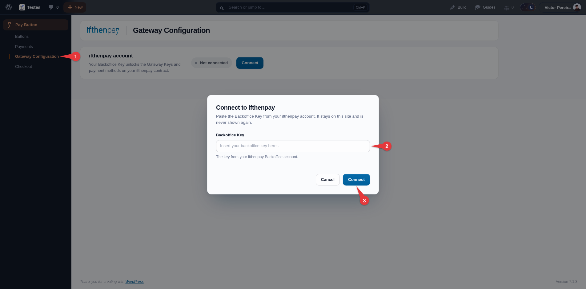
2. **(Admin Only) Step 2: choose the Gateway Key and the payment methods**
   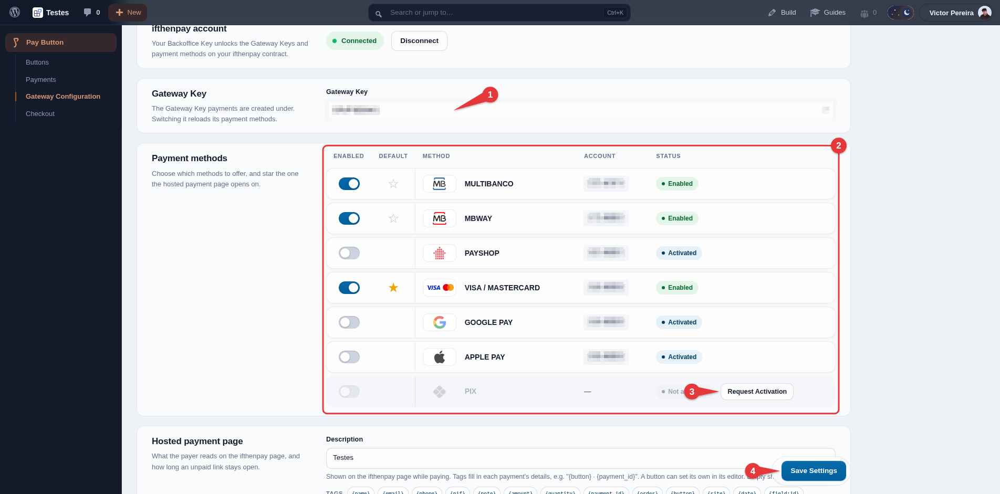
3. **(Admin Only) Step 3: set the ifthenpay page description, link expiry and weekly summary**
   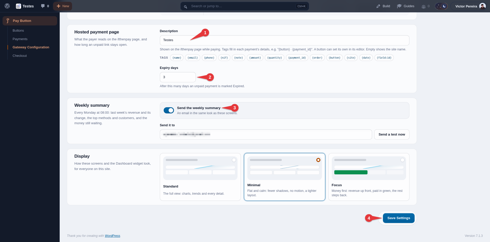
4. **(Admin Only) Step 4: create a pay button**
   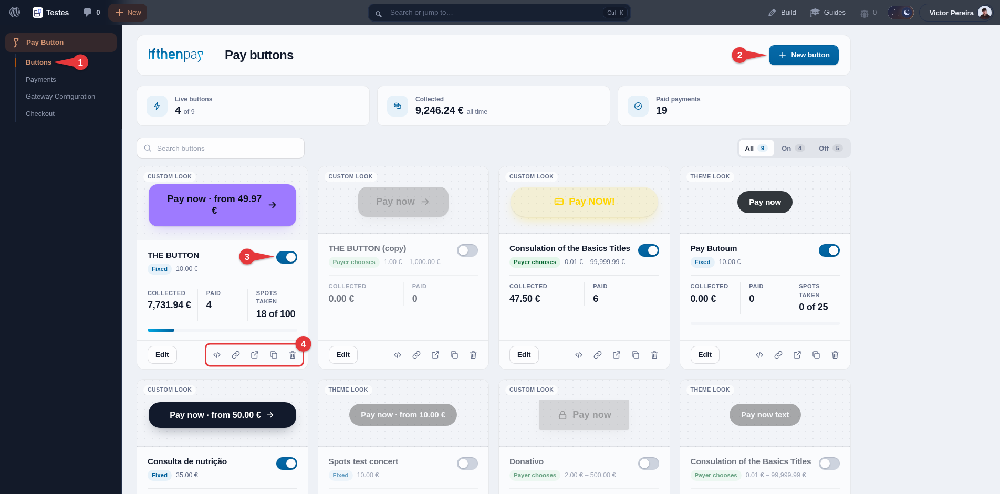
5. **(Admin Only) Step 5: the button's checkout — title, pay link and amount**
   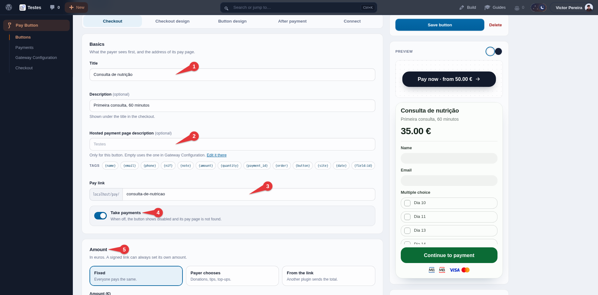
6. **(Admin Only) Step 6: ask for the payer's details and build the checkout form**
   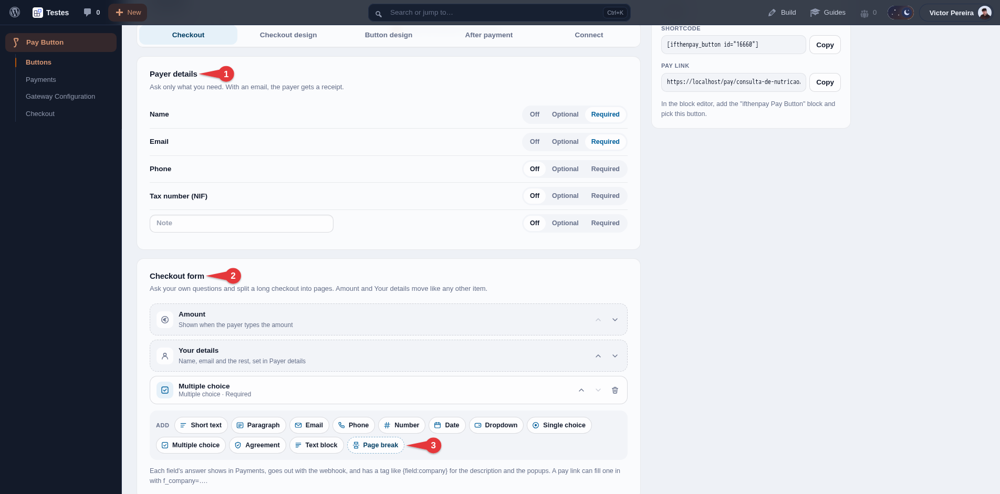
7. **(Admin Only) Step 7: optional — limit the spots, in total or per option**
   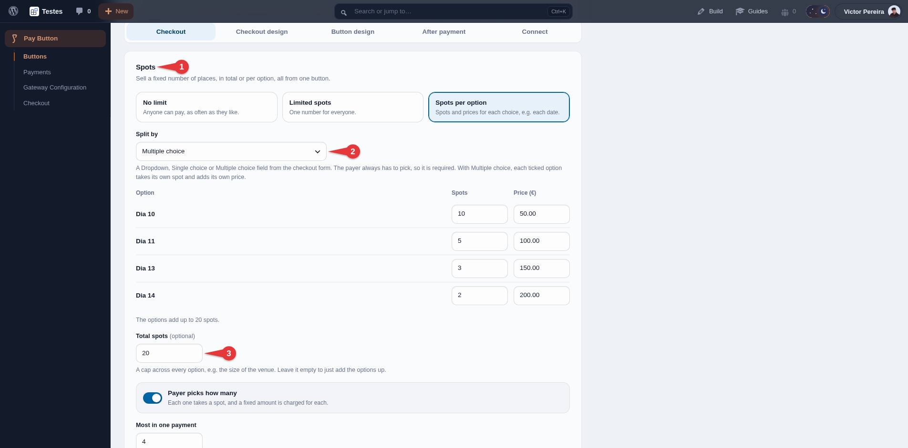
8. **(Admin Only) Step 8: design the button and save it**
   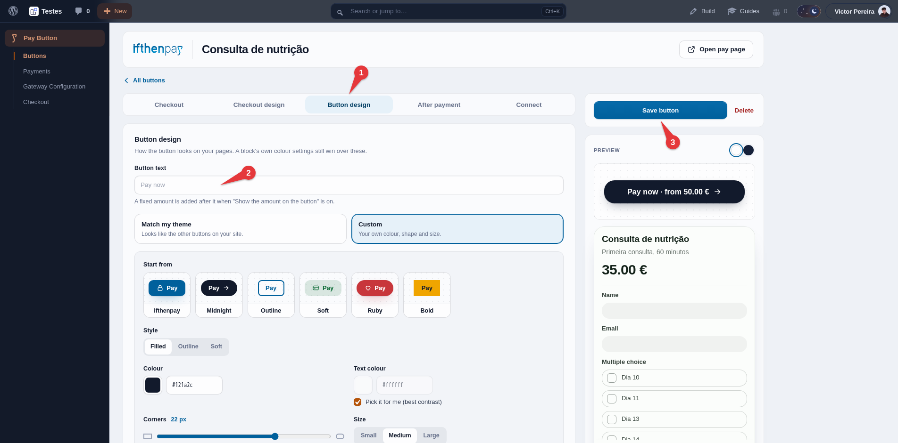
9. **(Admin Only) Step 9: place the button on a page, or share its pay link**
   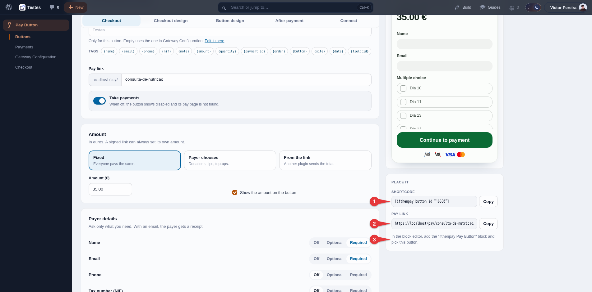
10. **(Admin Only) Optional: connect a form or booking plugin ifthenpay has no integration with**
    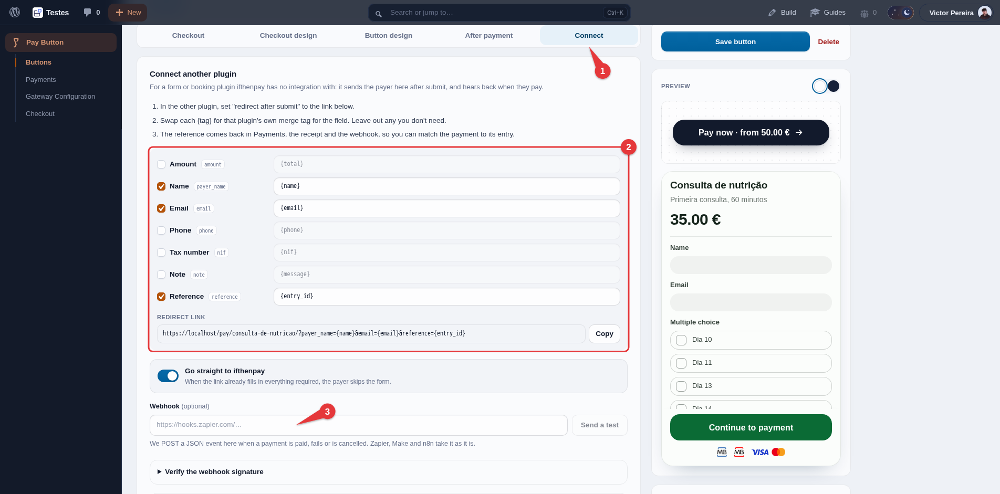
11. **(Admin Only) Checkout › Design: the look of the checkout, pay pages and popups**
    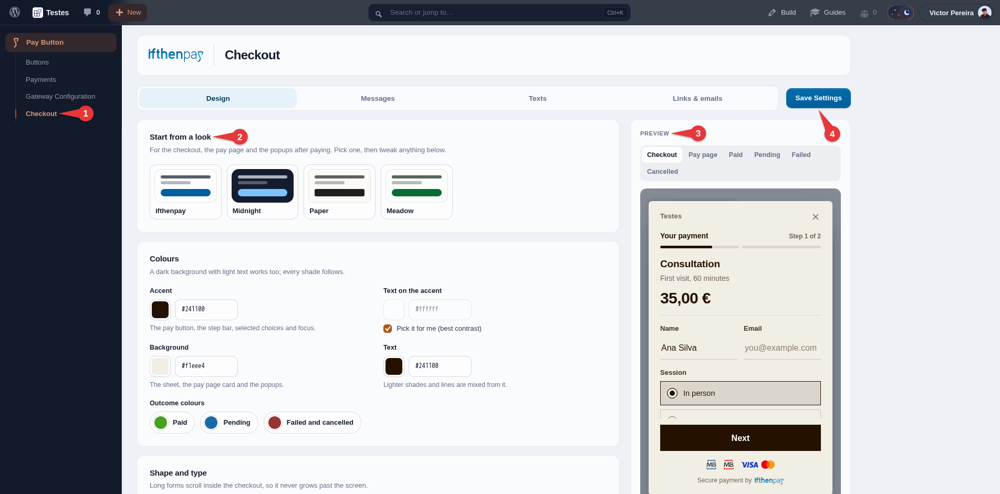
12. **(Admin Only) Checkout › Messages: what the payer sees after paying**
    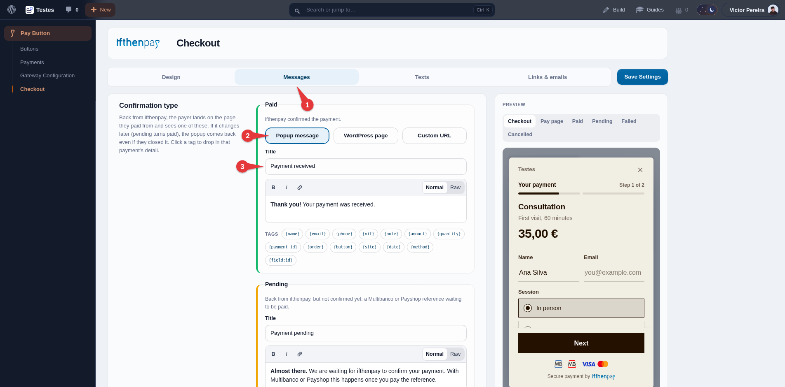
13. **(Customers Experience) The pay button on a page**
    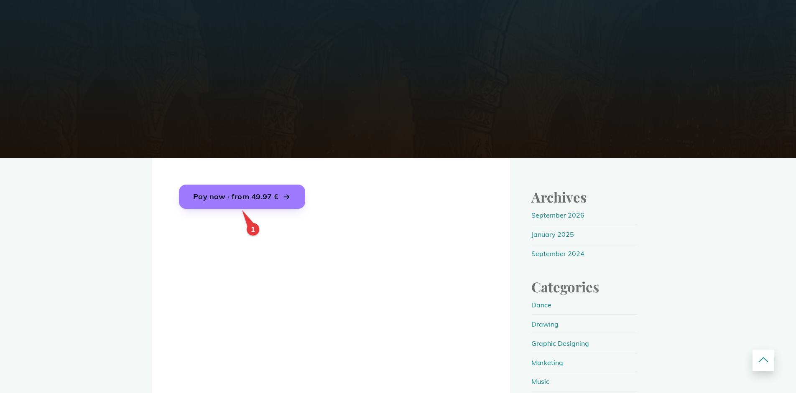
14. **(Customers Experience) The checkout, here on the button's own pay page**
    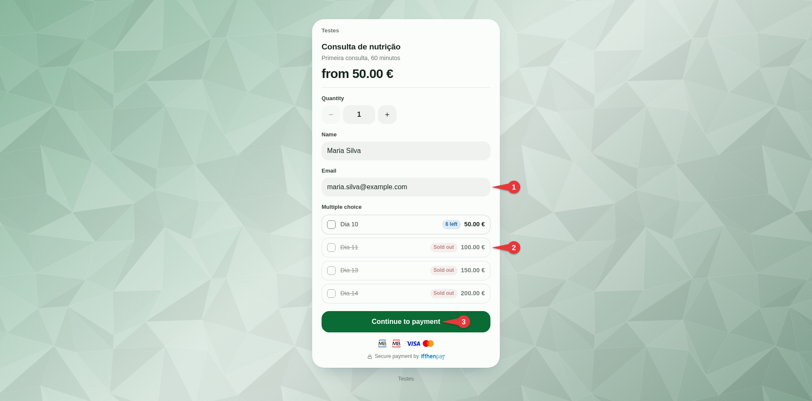
15. **(Customers Experience) ifthenpay's secure payment page**
    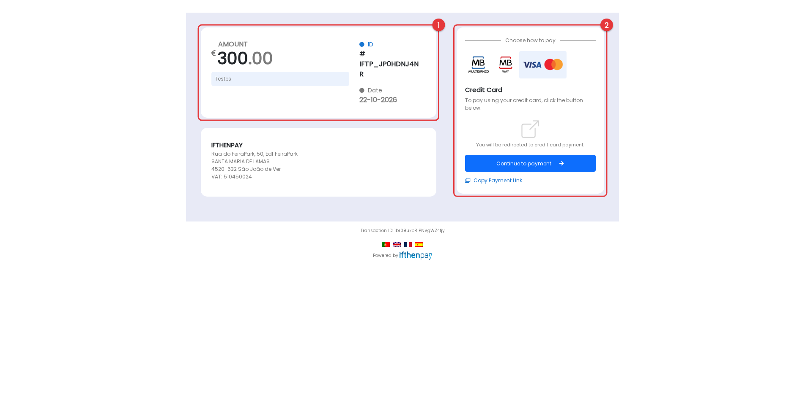
16. **(Customers Experience) The Paid popup back on your site**
    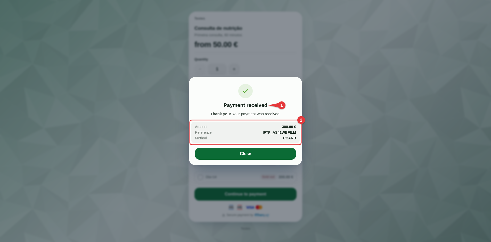
17. **(Admin Only) Payments: every payment, its status and the totals**
    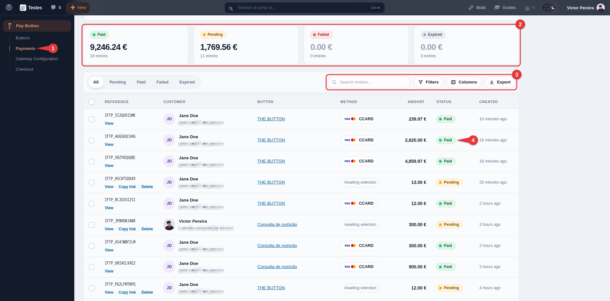
18. **(Admin Only) A payment's details**
    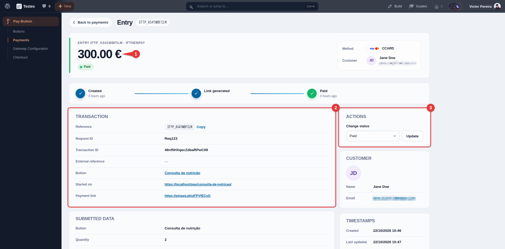

### Support

For assistance use the [WordPress.org support forum](https://wordpress.org/support/plugin/ifthenpay-pay-button/):

Pre-checks:

- Payment method enabled on Gateway Key AND mapped to Integration
- Running current recommended versions of WordPress & PHP

Commercial helpdesk available (no direct email required): [helpdesk.ifthenpay.com](https://helpdesk.ifthenpay.com/)

- **ifthenpay support**: [suporte@ifthenpay.com](mailto:suporte@ifthenpay.com)

### Security

Found a security issue? Please report it privately to [suporte@ifthenpay.com](mailto:suporte@ifthenpay.com) with "Security" in the subject, rather than in the public support forum. See [SECURITY.md](SECURITY.md) for the full policy.

### Changelog

Releases that fix a security issue say so in their entry, prefixed with **Security:**.

#### 1.0.0

- Initial public release: ifthenpay pay buttons (shortcode, block and a pay page per button) with fixed, payer-chosen or link-set amounts, a checkout form builder with multi-step pages and conditional questions, limited spots in total or per option, button and checkout design with a live preview, editable payer texts and messages, a redirect link builder, signed links and a signed outgoing webhook for other plugins, a direct request to your invoicing app when paid, revenue, abandonment and spots stats on the Buttons screen, webhook-confirmed payment status, receipts, the Payments screen with CSV export, a Dashboard widget, a weekly summary email, and automatic expiry of unpaid payments.
